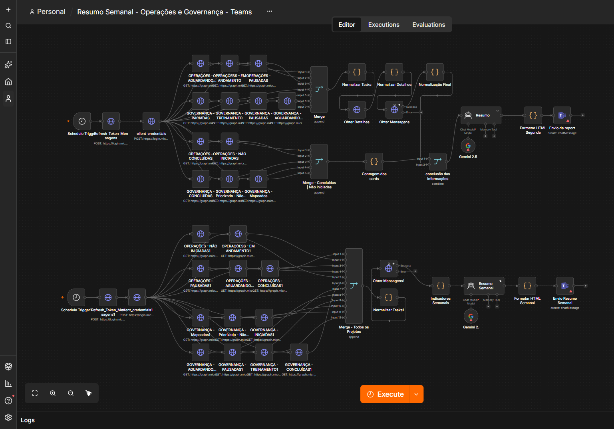
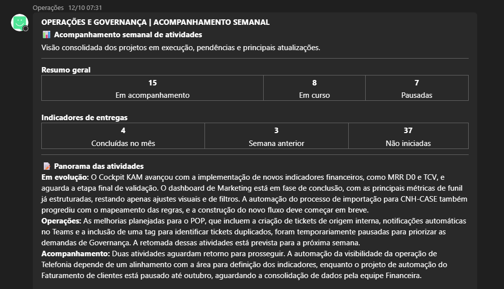
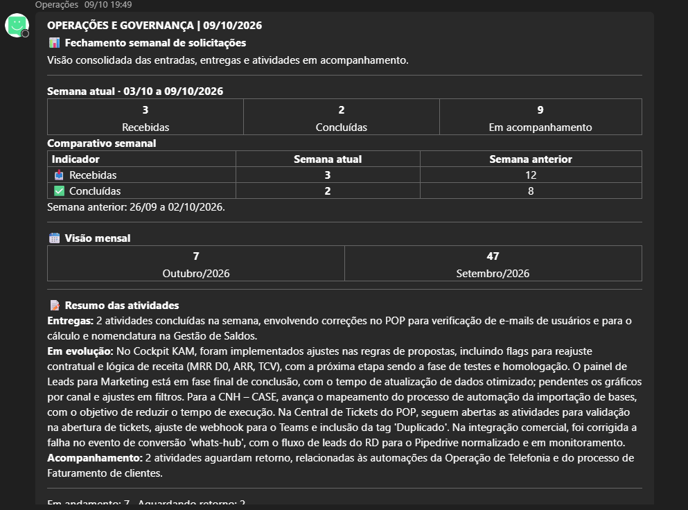
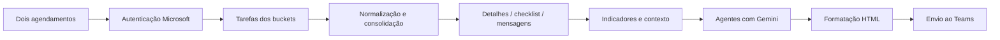

# Planner → Gemini → Teams: resumos automatizados

Case de automação com **n8n, Microsoft Graph, Planner, Gemini e Microsoft Teams**, complementar ao [dashboard Power BI com interface HTML e IA](https://github.com/alosiolemos/powerbi-planner-html-ai).

O objetivo é organizar atividades, detalhes e atualizações em relatórios recorrentes, reduzindo a necessidade de reunir essas informações manualmente. Não foi quantificada uma economia de horas nesta edição.

## Screenshots

Visão completa dos dois ramos da automação: acompanhamento de atividades e resumo semanal com IA.

## Resultado entregue no Microsoft Teams

Desenvolvi dois formatos de relatório para transformar os dados do Planner em comunicação útil para a equipe: **acompanhamento das atividades** e **fechamento semanal das solicitações**. As capturas abaixo mostram mensagens recebidas no Teams, com indicadores em tabelas e análise textual organizada em HTML.

### Acompanhamento de atividades

Panorama dos projetos em execução, pendências, entregas e próximos passos. A captura de 12/10 mostra 15 atividades em acompanhamento, sendo 8 em curso e 7 pausadas, além dos indicadores de entregas.

### Fechamento semanal

Entradas e conclusões da semana, comparação com o período anterior, visão mensal e resumo das atividades. A execução apresentada considera **03/10/2026 a 09/10/2026**: 3 recebidas, 2 concluídas e 9 em acompanhamento.

Os exemplos pertencem a recortes distintos; os totais não devem ser somados ou comparados como se representassem a mesma fotografia. A segunda captura é parcial: o texto completo complementa a visualização.

[Ver os textos dos relatórios e a explicação dos indicadores](docs/resultados-teams.md).

## O fluxo

O diagrama resume os dois ramos do workflow; não representa uma única sequência idêntica em ambas as rotinas.

## Entregas disponibilizadas

- Template JSON com a estrutura dos **51 nós**.
- Dois agendamentos e dois agentes conectados a nós Gemini.
- Oito códigos JavaScript extraídos dos nós Code.
- Prompts e documentação das entradas/saídas.
- Marcadores consistentes para planos, buckets, aplicação e destino.
- Explicação do vínculo com o painel Power BI.

## Template para configurar

[Baixar o JSON preparado](workflows/planner-ai-teams.template.json).

**O fluxo está inativo e os dois nós de envio ao Teams estão desabilitados.** Credenciais e identificadores originais foram retirados. O JSON requer configuração e teste em uma instância n8n compatível; a importação no n8n não foi executada nesta preparação.

Não se trata de um export conectado ao ambiente original. O fluxo de origem permaneceu intocado.

## Rotinas identificadas

| Ramo | Agendamento da versão pública | Objetivo |
| --- | --- | --- |
| Acompanhamento | Segunda-feira, 07h30 | Consolidar tarefas, detalhes e mensagens e formatar acompanhamento |
| Fechamento | Sexta-feira, 19h | Calcular indicadores e preparar resumo semanal |

O template fixa America/Sao_Paulo. O export original não informava esse fuso nas configurações; a escolha pública foi explicitada para evitar depender do padrão de outra instância.

Os nomes históricos dos nós foram preservados, mas os dois nós de modelo usam **models/gemini-2.5-pro** nos parâmetros exportados. Um nome de nó contendo 2.5 não determina o modelo sozinho. A disponibilidade do modelo precisa ser validada antes de conectar.

## Documentação

- [Arquitetura e dois ramos](docs/arquitetura.md)
- [Configuração e importação](docs/configuracao.md)
- [Normalização, métricas e relatórios](docs/processamento.md)
- [Resultado entregue no Teams e exemplos de mensagens](docs/resultados-teams.md)
- [Inventário de nós](docs/inventario-nos.md)
- [Preparação pública e cuidados de uso](docs/publicacao.md)
- [Verificações realizadas](docs/validacao.md)

## Código e prompts

Os arquivos em [code](code/01-node.js) são corpos de nós Code do n8n e dependem de items, $input e/ou referências a outros nós. Não são scripts de terminal independentes.

Os prompts foram separados em [prompts](prompts/01-agente.md). A resposta gerada precisa de revisão conforme a finalidade; uma hipótese de gargalo ou causa raiz não é uma conclusão comprovada.

## Complemento ao Power BI

O painel permite exploração interativa. O n8n consulta o Graph diretamente e distribui a análise, sem depender de uma leitura do dataset do Power BI no fluxo fornecido.

A integração é do processo operacional e da fonte comum. Esta preparação não executou chamadas de rede nem enviou mensagens.

Código disponibilizado sob [licença MIT](LICENSE). As capturas e os exemplos de execução são evidências do case; podem conter marcas e contexto operacional de terceiros e não ampliam a licença do código.
